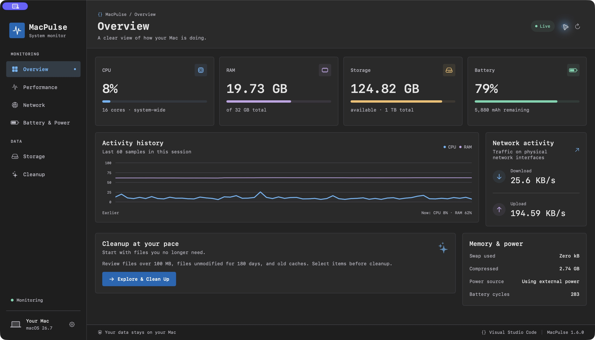
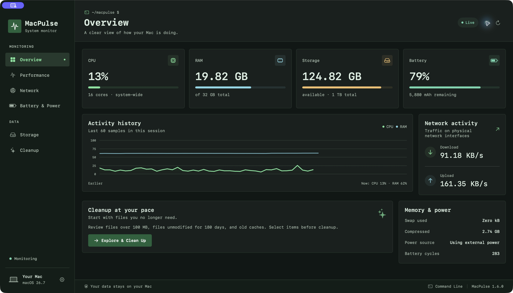
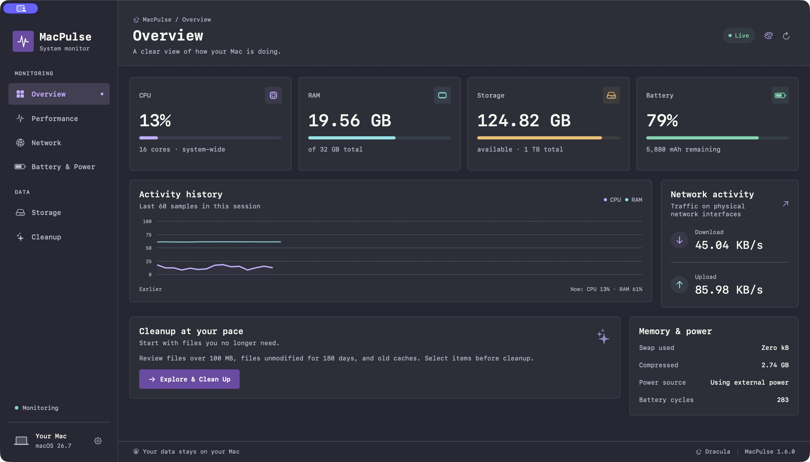

# MacPulse

[English](README.md) · [Giấy phép MIT](LICENSE) · [Hướng dẫn đóng góp](CONTRIBUTING.md)

**Trạng thái:** dự án mới, đang phát triển. Đã chạy kiểm thử tự động, build Universal, kiểm tra bố cục và thao tác đổi giao diện trên macOS; toàn bộ luồng chuyển vào Thùng rác vẫn cần kiểm tra thủ công. Xem [kết quả xác minh](VERIFICATION.md).

App macOS native bằng SwiftUI, giao diện tiếng Việt và tiếng Anh, theo dõi tài nguyên trực tiếp và giúp xem lại những file có thể dọn. Yêu cầu macOS 14 trở lên. Không có dịch vụ mạng hay tài khoản. Theo dõi cơ bản dùng framework Apple; đọc pin iPhone/iPad qua USB dùng công cụ libimobiledevice cài riêng.



*Ảnh app macOS đang chạy, số liệu trực tiếp, giao diện tiếng Anh và theme Visual Studio Code ở chế độ Dark.*

## iPhone và iPad

Đã có bản native cho **iOS/iPadOS 17+**, project `iOS/MacPulse.xcodeproj`, scheme **MacPulse-iOS**. Có tab trên iPhone, thanh bên trên iPad, cùng theme và Việt/Anh. CPU/RAM chỉ đo tiến trình MacPulse; không suy ra mAh pin và không dọn cache của app khác. Quét file trong thư mục bạn chọn qua Files, có khu khôi phục và xác nhận xóa vĩnh viễn.

[Xem cách cài bằng Xcode, ký app và giới hạn iOS](docs/iOS.vi.md) · [English guide](docs/iOS.md)

## Đọc pin iPhone/iPad qua USB

Trong **Pin & nguồn điện**, cài công cụ tùy chọn (`brew install libimobiledevice`), kết nối USB, mở khóa và chọn Tin cậy. Chọn thiết bị rồi **Đọc pin qua USB** để xem dung lượng thiết kế, sạc đầy, còn lại và số chu kỳ khi firmware cung cấp trường được hỗ trợ. **Xuất báo cáo pin** thành JSON, chuyển sang iPhone/iPad và nhập ở Tổng quan. Đây là bản ghi có thời điểm đọc, không thay thế mức pin trực tiếp. Báo cáo không chứa UDID/số sê-ri.

[Hướng dẫn, định dạng và giới hạn](docs/USB-battery.vi.md) · [English](docs/USB-battery.md)

## Mở app trên Mac

Sau khi build, mở `dist/MacPulse.app`. Có thể kéo app vào Applications nếu muốn cài đặt. Đóng cửa sổ vẫn theo dõi bằng biểu tượng trên thanh menu; chọn **Thoát MacPulse** để dừng hoàn toàn.

Đổi ngôn ngữ bằng biểu tượng bánh răng hoặc **⌘, → Cài đặt chung / General → Ngôn ngữ / Language → English / Tiếng Việt / Theo hệ thống**. Lựa chọn được lưu và áp dụng ngay cho nội dung app, thanh menu riêng và thông báo, kể cả kết quả quét đang có. Hộp thoại và menu tiêu chuẩn do macOS quản lý vẫn theo thiết lập ngôn ngữ của macOS.

## Đổi theme

Bấm **biểu tượng bảng màu** ở góc trên bên phải để chọn **Ocean, Forest, Violet, Graphite, Command Line, Visual Studio Code hoặc Dracula**, kết hợp với chế độ **Theo hệ thống / Sáng / Tối**. Vào **Cài đặt (⌘,) → Giao diện** để cuộn xem trước từng bảng màu. Chế độ Theo hệ thống cập nhật theo giao diện macOS, kể cả khi hệ thống tự chuyển sáng/tối.

Ba theme mới dùng font monospace, khoảng cách gọn và khung ít bo góc. Command Line có màu xanh terminal và dấu nhắc lệnh; Visual Studio Code dùng nền editor trung tính cùng điểm nhấn xanh/tím; Dracula kết hợp tím và cyan. Cả ba đều hỗ trợ sáng và tối. Tên theme mô tả cảm hứng giao diện; MacPulse là ứng dụng độc lập.

| Command Line · Dark | Dracula · Dark |
| --- | --- |
|  |  |

Lựa chọn được lưu và dùng chung cho cửa sổ app, Cài đặt, bảng trên thanh menu và hộp xác nhận của app. Đổi theme giữ nguyên lịch sử theo dõi, kết quả quét và file đã chọn. Màu đánh giá an toàn vẫn có ý nghĩa xanh/vàng/đỏ riêng. Biểu tượng trên thanh menu và hộp thoại do macOS quản lý dùng kiểu hiển thị của hệ thống.

## Tính năng

- CPU: tỷ lệ toàn hệ thống, user/system/idle và biểu đồ 60 mẫu gần nhất.
- RAM: bộ nhớ đang dùng, wired, compressed, cache, swap và áp lực bộ nhớ nếu macOS cung cấp.
- Storage: tổng dung lượng, đang dùng và còn trống trên volume chứa thư mục cá nhân.
- Pin: phần trăm, điện lượng còn lại bằng mAh, dung lượng điện sạc đầy và dung lượng thiết kế do firmware báo được ghi riêng; số chu kỳ, điện áp, dòng điện và thời gian ước tính.
- Mạng: trang riêng hiển thị tốc độ upload/download, biểu đồ 60 mẫu, đỉnh trong biểu đồ, tổng quan sát trong phiên và từng giao diện; đổi MB/s ↔ Mbps và xem tốc độ ngay trên thanh menu.
- Dọn dẹp: thư mục tùy chọn, file từ 100 MB, file chưa chỉnh sửa từ 180 ngày; có thể quét thêm cache/log người dùng từ 30 ngày.
- Tìm theo tên/đường dẫn, lọc loại, hiện trong Finder, chọn nhiều file và xem danh sách xác nhận trước khi chuyển vào Thùng rác.
- Đánh giá từng file: **ít rủi ro / cần xem lại / không khuyến nghị**, ghi rõ lý do; có bộ lọc và nút chọn chỉ các mục ít rủi ro đang hiển thị.
- Giao diện thống nhất, 7 theme và 3 chế độ sáng/tối, có bản xem trước và lưu lựa chọn.
- Cài đặt chu kỳ lấy mẫu 1/2/5 giây và hiển thị trên thanh menu.

## Theo dõi upload/download

Chọn **Mạng** ở thanh bên hoặc nút mũi tên trong thẻ mạng của Tổng quan. App hiển thị tốc độ tức thời, biểu đồ 60 mẫu gần nhất, đỉnh trong biểu đồ, dung lượng quan sát được trong phiên và tốc độ/trạng thái từng giao diện vật lý. “Đang hoạt động” là trạng thái giao diện, không phải xác nhận có Internet.

Đổi đơn vị **KB/s · MB/s** hoặc **Kbps · Mbps** ngay trên trang Mạng hoặc trong **⌘, → Cài đặt chung → Đơn vị tốc độ mạng**. **1 MB/s = 8 Mbps**. Lựa chọn áp dụng cho trang Mạng, Tổng quan và thanh menu. Có thể tắt tốc độ trên thanh menu trong Cài đặt.

App dùng bộ đếm 64-bit và thời gian thực giữa hai mẫu; không gửi yêu cầu speed test và không thu thập nội dung gói tin, SSID hay địa chỉ IP. Lưu lượng gồm Internet, mạng nội bộ và tác vụ nền trên các giao diện vật lý được hỗ trợ; không cộng thêm bộ đếm của VPN/bridge/loopback. Mẫu đầu, giao diện mới/kết nối lại, bộ đếm bị đặt lại hoặc khoảng mất số liệu sẽ lấy mốc mới, không suy ra tốc độ đột biến. Tổng phiên chỉ cộng các khoảng hợp lệ, đặt lại khi thoát app và không dùng làm số liệu tính cước.

## Cách dọn file

1. Mở **Dọn dẹp** → **Chọn thư mục…** hoặc dùng Downloads mặc định.
2. Bật quét thêm cache/log nếu muốn, rồi **Bắt đầu quét**. Quét chỉ đọc metadata, không tự chọn file.
3. Xem mức đánh giá, lý do từng file và dùng biểu tượng thư mục để kiểm tra trong Finder. Ngày chỉnh sửa cũ chỉ là gợi ý, không chứng minh file đã hết sử dụng. Nút **Chọn chỉ mục ít rủi ro** thay thế lựa chọn hiện tại bằng các mục ít rủi ro đang hiển thị.
4. Chọn file → **Chuyển vào Thùng rác** → kiểm tra danh sách rồi xác nhận.
5. File vẫn chiếm dung lượng cho đến khi tự dọn Thùng rác trong Finder. Có thể dùng **Put Back / Đặt lại** trong Finder để khôi phục trước đó.

MacPulse không xóa vĩnh viễn, không gỡ ứng dụng, không dọn RAM cưỡng bức và không can thiệp hệ thống. Quét bỏ qua file ẩn, symlink, alias, app/package, thư mục phát triển `node_modules`, vùng hệ thống và Library ngoài Caches/Logs. Không tải file iCloud chỉ có trên cloud. Trước khi chuyển file, app kiểm tra lại đường dẫn, inode, dung lượng và ngày sửa để bỏ qua file đã thay đổi. Cache có thể được ứng dụng tạo lại; không nên chọn file nếu chưa biết công dụng.

**Ít rủi ro** chỉ áp dụng cho một số file `.cache`, `.tmp`, `.temp` trong thư mục cache chuẩn và nhật ký cũ nhận diện được trong Logs. Các ngày sửa/tạo/truy cập được cung cấp phải cũ ít nhất 30 ngày, kiểm tra file đang mở phải hoàn tất, và chưa quan sát thấy file hoặc ứng dụng sở hữu đang hoạt động. Đây là gợi ý, không phải bảo đảm an toàn tuyệt đối; cache có thể cần tải lại, còn xóa log sẽ mất lịch sử chẩn đoán.

**Cần xem lại** dành cho file cá nhân, định dạng chưa nhận diện, hoạt động gần đây hoặc kiểm tra chưa đầy đủ. **Không khuyến nghị** và chặn chọn đối với file đang mở, cache/log của app đang chạy, dữ liệu đồng bộ nhận diện được, cơ sở dữ liệu, khóa bảo mật, bản sao lưu, file tải dở, file bị khóa hoặc nhiều liên kết.

App dùng `lsof` cho các tiến trình của người dùng hiện tại và đọc danh sách ứng dụng đang chạy; không dùng sudo, không đọc nội dung file và không gửi danh sách lên mạng. Khi lệnh cảnh báo, lỗi, không có kết quả hoặc hết thời gian, app không gắn nhãn ít rủi ro. Trước khi chuyển vào Thùng rác, app lấy lại ảnh chụp trạng thái sử dụng và đánh giá lại; nếu file bị chặn hoặc mục ít rủi ro không còn đạt tiêu chí, app bỏ qua. Kiểm tra chỉ có giá trị tại thời điểm thực hiện và không phát hiện được mọi tình huống hay dịch vụ đồng bộ.

Nếu macOS từ chối truy cập, chọn lại thư mục bằng hộp thoại hoặc cấp quyền **Cài đặt hệ thống → Quyền riêng tư & Bảo mật → Tệp và thư mục**. App không yêu cầu quyền quản trị. Quét giới hạn 100.000 mục/lần; thư mục quá lớn nên chia thành các thư mục con. Kết quả không được lưu giữa các lần mở app.

## Build & kiểm thử

Cần Xcode hoặc Command Line Tools có Swift 6 trở lên.

```sh
git clone https://github.com/devoralabsapp/MacPulse.git
cd MacPulse
bash scripts/test.sh
bash scripts/build-app.sh
open dist/MacPulse.app
```

Build Universal cho cả Apple Silicon và Intel:

```sh
bash scripts/build-app.sh --universal
```

Đầu ra gồm `dist/MacPulse.app` và `dist/MacPulse.zip`. App được ký ad hoc cho sử dụng cục bộ; chưa có chữ ký Developer ID/notarization để phân phối công khai. Nếu phân phối, hãy đặt bundle ID của bạn, ký bằng Developer ID và notarize theo quy trình Apple. Mở `Package.swift` trong Xcode để phát triển; bản `.app` từ script có Info.plist, biểu tượng và định danh ổn định cho quyền thư mục.

Tests dùng thư mục tạm riêng: phân loại tuổi/kích thước, cache mới, symlink, thư mục được bảo vệ, giới hạn quét, hủy, chống trùng, phát hiện file thay đổi/thay thế và kiểm tra parser pin không nhầm `%` thành `mAh`. Không test bằng cách xóa file của người dùng.

## Nguồn số liệu & giới hạn

- CPU: `host_statistics`; mẫu đầu cần chờ một chu kỳ để tính delta.
- RAM: `host_statistics64` và `vm.swapusage`; dùng active + inactive − purgeable − file-backed + wired + compressed. RAM và swap dùng đơn vị nhị phân (1024) với nhãn GB theo macOS: máy 32 GiB sẽ hiển thị **32 GB**, không còn 34,36 GB. Ổ đĩa và dung lượng file vẫn dùng hệ thập phân. Có thể chênh lệch Giám sát hoạt động do thời điểm lấy mẫu và cách phân loại.
- Storage: `volumeTotalCapacity` / `volumeAvailableCapacity` của thư mục cá nhân. APFS và dung lượng có thể thu hồi khiến số khác màn hình Storage trong Cài đặt. Dung lượng file trong bộ quét là logical size, không phải cam kết dung lượng thực thu hồi (APFS clone, sparse file và nén có thể khác).
- Pin: IOPS cung cấp `%` và trạng thái nguồn; IOKit `AppleSmartBattery` cung cấp điện lượng mAh, bao gồm các trường trong `BatteryData` trên phiên bản macOS mới. Thiếu dữ liệu sẽ hiển thị `—`, không lấy phần trăm đổi thành mAh.
- Dung lượng thiết kế lấy từ `DesignCapacity`, không thay bằng dung lượng sạc đầy hoặc `Qmax`. Nếu firmware báo sạc đầy lớn hơn mốc thiết kế, app giữ nguyên hai số đọc nhưng cảnh báo cần xác minh và không tính sức khỏe pin từ cặp số đó; không hiện trên 100%, không tự sửa mốc thiết kế hoặc ép kết quả về 100%. Tình trạng do macOS báo được hiển thị riêng. Số đọc firmware không phải phép đo dung lượng vật lý độc lập. Dòng điện dương khi sạc, âm khi xả, có thể bằng 0 khi giữ mức sạc.

Tham khảo API chính thức: [IOPowerSources](https://developer.apple.com/documentation/iokit/iopowersources_h), [IOPMPowerSource](https://developer.apple.com/documentation/kernel/iopmpowersource), [NSWorkspace.recycle](https://developer.apple.com/documentation/appkit/nsworkspace/recycle(_:completionhandler:)).

## Mã nguồn mở

MacPulse phát hành theo [MIT License](LICENSE). Xem [hướng dẫn đóng góp](CONTRIBUTING.md), [lộ trình](ROADMAP.md) và [chính sách báo lỗi bảo mật](SECURITY.md). Bản dịch có trong `Sources/MacPulseCore/Resources/{en,vi}.lproj/Localizable.strings`.

Dự án được phát triển ban đầu với sự hỗ trợ của OpenAI Codex. MacPulse là dự án độc lập; không tuyên bố được OpenAI tài trợ hoặc đã được chấp nhận vào chương trình nào.
